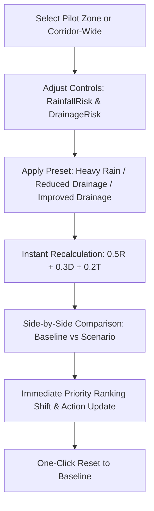
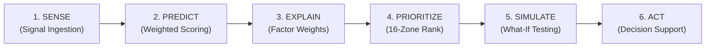

# CIVISENSE — Predict. Prioritize. Prevent.
### Explainable Civic Waterlogging Risk Intelligence & Decision-Support Platform
*Gharuan–Kharar Pilot Demonstration near Chandigarh University &bull; Zinnovatio 4.0 Hackathon Finale*


---

## 1. Executive Summary & Geographic Pilot

**CIVISENSE** is a technically credible, highly interactive civic waterlogging risk intelligence and decision-support platform built for the **Zinnovatio 4.0 Hackathon Finale**.

### Geographic Scope: Gharuan–Kharar Pilot (Chandigarh University Corridor)
- **Pilot Location**: Punjab / SAS Nagar District along the **NH-05 Ludhiana–Chandigarh corridor** (latitude ~`30.71` to `30.79`, longitude ~`76.56` to `76.69`).
- **Target Zones**: 16 geographically-accurate demonstration catchments spanning Chandigarh University Main Campus, CU North Campus, Gharuan Village lowlands, Kharar Elevated Flyover Underpass, Khanpur Chowk bypass, and Desu Majra railway viaduct.
- **Topographical Context**: Ground elevations range between ~**294m and 312m MSL**, reflecting natural water accumulation basins and underpass siphons along the highway.
- **Zero Fragmented Portals**: A single, unified platform accessible by all stakeholders with zero login friction.
- **Data Transparency**: All baseline zones and telemetry readings are clearly labeled as **calibrated synthetic demonstration data**. The platform never fabricates live telemetry hardware, official flood incident records, or inflated machine learning metrics.

---

## 2. Centralized Explainable Risk Engine

CIVISENSE implements a centralized, fully testable, and auditable risk calculation across all platform views:

$$\text{Risk Score} = 0.5 \times \text{RainfallRisk} + 0.3 \times \text{DrainageRisk} + 0.2 \times \text{TerrainRisk}$$

### Mathematical Specifications:
- **Inputs strictly between $0$ and $100$**:
  - **$\text{RainfallRisk}$ (50% weight)**: Precipitation influx volume along the highway catchment.
  - **$\text{DrainageRisk}$ (30% weight)**: Higher value denotes greater drainage-related risk (e.g. choked culverts, silt buildup, inadequate cross-sectional throughput).
  - **$\text{TerrainRisk}$ (20% weight)**: Topographical pooling hazard (low-lying elevation depressions acting as gravity sinks).
- **Consistent Risk Thresholds**:
  - 🔴 **Critical Risk**: $\ge 80.0$ (P1 – Immediate Intervention)
  - 🟠 **High Risk**: $\ge 60.0$ and $< 80.0$ (P2 – High Priority)
  - 🟡 **Medium Risk**: $\ge 35.0$ and $< 60.0$ (P3 – Moderate Watch)
  - 🟢 **Low Risk**: $< 35.0$ (P4 – Low / Routine)
- **Transparency Notice**: This rule-based multi-criteria weighted scoring engine is designed for transparent municipal decision support and is **not described as an unverified machine learning model**.

---

## 3. Flagship Feature: What-If Simulator

The interactive simulation engine allows municipal engineers and emergency planners to stress-test changing conditions in real time:



### Simulator Capabilities:
1. **Zone Selection**: Target specific zones (e.g., Chandigarh University Campus, Kharar Flyover) or test corridor-wide scenarios.
2. **Direct Risk Controls**: Direct sliders for $\text{RainfallRisk}$ (0–100) and $\text{DrainageRisk}$ (0–100), as well as rainfall delta and drainage capacity override.
3. **Standard Presets**:
   - **Heavy Rainfall Stress**: Sets $\text{RainfallRisk} = 85.0$ (+30 pts storm surge).
   - **Reduced Drainage Capacity**: Sets $\text{DrainageRisk} = 90.0$ (simulates choked culverts and trash grate blockage).
   - **Improved Drainage Conditions**: Sets $\text{DrainageRisk} = 20.0$ (simulates proactive desilting and clear conduit conveyance).
   - **Compound Storm Surge**: Extreme compound stress test with 90/100 rain and 85/100 drainage choke.
4. **Side-by-Side Comparison**: Displays Baseline score vs Simulated score, risk category shift, inundation depth shift, and priority shift.
5. **Instant Reset**: One-click **Reset to Baseline** button immediately restores default calibrated parameters without reloading.
6. **Action Guidance**: Explains *why* risk changed and generates targeted engineering responses.

---

## 4. The Six-Step Core Decision Loop



1. **SENSE**: Collects rainfall gauge data, acoustic water depth indicators, silt sonars, and citizen complaints.
2. **PREDICT**: Evaluates zone-level risk percentage, projected inundation depth, and time-to-peak lead time.
3. **EXPLAIN**: Decomposes causal drivers through the $50/30/20$ formula breakdown.
4. **PRIORITIZE**: Ranks all 16 pilot zones automatically by calculated risk.
5. **SIMULATE**: Tests parametric stress scenarios with instant side-by-side recalculation.
6. **ACT**: Suggests targeted inspection and preventive measures (**does not claim automated emergency dispatch**).

---

## 5. Website Views and Features

| View | Purpose & Functionality |
| :--- | :--- |
| **Home Overview** | Fixed hero typography, pilot corridor branding, live KPIs, 6-step loop breakdown, and real-time counter grid. |
| **Command Center** | Executive dashboard where all summary cards derive strictly from the underlying 16-zone dataset, 24-hr rainfall forecast curve, and searchable risk matrix. |
| **GIS Risk Map** | Fullscreen Leaflet map centered on Gharuan–Kharar (`30.755, 76.620`, zoom 12.5) with color-coded polygons, pins, telemetry popup, and zone inspector drawer. |
| **AI Prediction** | Interactive multi-variable calculator accepting rainfall intensity, drainage capacity, traffic congestion, elevation MSL, and citizen reports. |
| **What-If Simulator** | Flagship interactive stress-testing engine with direct risk controls, presets, side-by-side before/after comparison, and instant baseline reset. |
| **Explainable AI (XAI)** | Full mathematical auditability of the $0.5R + 0.3D + 0.2T$ formula, factor contributions, and counterfactual mitigation pathways. |
| **Priority Management** | Auto-ranked list of all 16 zones from highest to lowest risk with priority tiers (P1 Immediate to P4 Routine) and suggested actions. |
| **Preventive Measures** | Decision-support suggestions (culvert inspection, drain desilting, pump pre-positioning, traffic advisories) with status tracking. |
| **Reports & Analytics** | Historical trends, zone risk audit table, printable PDF layout, and one-click **CSV Dataset Export**. |
| **About CiviSense** | Municipal problem statement, proposed solution, architecture, data ethics notice, and future roadmap. |

---

## 6. Quick Start & Setup Instructions

### Prerequisites
- **Python 3.10+** (Tested on Python 3.14)
- **Node.js v18+** & **npm**

### Step 1: Install Python & Frontend Dependencies
```bash
# Backend dependencies
python -m pip install fastapi uvicorn pydantic

# Frontend dependencies
cd frontend
npm install
cd ..
```

### Step 2: Seed SQLite Database
```bash
python backend/seed_data.py
```
*Seeds all 16 Gharuan–Kharar pilot demonstration zones, 24 sensor nodes, and initial preventive maintenance logs.*

### Step 3: Start the Backend Server
```bash
python -m uvicorn backend.main:app --host 127.0.0.1 --port 8000 --reload
```
*FastAPI runs on `http://127.0.0.1:8000` with Swagger documentation at `http://127.0.0.1:8000/docs`.*

### Step 4: Start the Frontend Application
In a second terminal:
```bash
cd frontend
npm run dev -- --host 127.0.0.1
```
*Vite frontend runs on `http://127.0.0.1:5173` with automated proxying to the backend API.*

### Step 5: Run Automated Verification Test Suite
```bash
python test_system.py
```

---

## 7. Automated Test Results

```text
======================================================================
CIVISENSE COMPLETE SYSTEM TEST SUITE: GHARUAN–KHARAR PILOT (16 ZONES)
======================================================================
  [PASS] Root Health (GET http://127.0.0.1:8000/) -> HTTP 200
       -> Pilot Corridor: Gharuan–Kharar Pilot (Chandigarh University Corridor, NH-05 Punjab)
       -> Centralized Formula: Risk = 0.5 * RainfallRisk + 0.3 * DrainageRisk + 0.2 * TerrainRisk
  [PASS] Dashboard Summary (GET http://127.0.0.1:8000/api/dashboard/summary) -> HTTP 200
       -> Total Pilot Zones: 16
       -> Critical: 5, High: 5, Medium: 4, Low: 2
       -> Average Corridor Risk: 63.0%
  [PASS] Pilot Zones List (16 Zones) (GET http://127.0.0.1:8000/api/wards) -> HTTP 200
       -> Loaded 16 pilot zones with accurate boundaries & elevations (~294-310m)
  [PASS] Zone #1 Detail (Chandigarh University) (GET http://127.0.0.1:8000/api/wards/1) -> HTTP 200
       -> Zone 1: Chandigarh University Main Campus & Sports Arena (ZONE-GK-01)
       -> Elevation: 308.5m MSL, Calculated Risk: 50.5%
  [PASS] Sensors List (GET http://127.0.0.1:8000/api/wards/sensors/all) -> HTTP 200
       -> Loaded 24 demonstration telemetry stations
  [PASS] Risk Engine (0.5R + 0.3D + 0.2T Formula Verification) (POST http://127.0.0.1:8000/api/predict) -> HTTP 200
       -> Formula Evaluation: 0.5*80 + 0.3*70 + 0.2*60 = 73.0% (High)
       -> Recommended Measure: Inspect primary storm conduit grates and clear surface debris...
  [PASS] Simulator Presets (GET http://127.0.0.1:8000/api/simulator/presets) -> HTTP 200
       -> Presets verified: ['baseline', 'heavy_rainfall', 'reduced_drainage', 'improved_drainage', 'extreme_compound']
  [PASS] Simulator Baseline State (GET http://127.0.0.1:8000/api/simulator/baseline) -> HTTP 200
       -> Verified baseline state for all 16 zones
  [PASS] What-If Simulation (Heavy Rainfall Preset: 85/100) (POST http://127.0.0.1:8000/api/simulator/run) -> HTTP 200
       -> Baseline Avg: 63.0% -> Simulated Avg: 72.7%
       -> Delta: +9.7 pts, Critical count: 6
  [PASS] What-If Simulation (Zone 1 CU Campus Targeted) (POST http://127.0.0.1:8000/api/simulator/run) -> HTTP 200
       -> Zone 1 Baseline: 50.5% (Medium)
       -> Zone 1 Simulated: 75.0% (High)
       -> Delta Summary: Risk escalated by +24.5 points (Medium -> High).
  [PASS] Global Explainable AI Breakdown (GET http://127.0.0.1:8000/api/explain/global) -> HTTP 200
       -> Verified 50/30/20 weights & thresholds without ML claims
  [PASS] Zone 1 Local XAI Breakdown (GET http://127.0.0.1:8000/api/explain/ward/1) -> HTTP 200
       -> Primary Reason: Moderate rainfall conditions (65.0/100) contribute steady hydraulic influx.
       -> Counterfactual 1: Preventive Drain Desilting & Trash Screen Clearing
  [PASS] Preventive Measures & Inspection Suggestions (GET http://127.0.0.1:8000/api/mitigation/recommendations) -> HTTP 200
       -> Generated 39 suggested inspection & preventive measures across 16 pilot zones
  [PASS] Log Preventive Inspection Task (POST http://127.0.0.1:8000/api/mitigation/log) -> HTTP 200
       -> Task logged: ACT-20261030120912
  [PASS] Update Task ACT-20261030120912 Status (PATCH http://127.0.0.1:8000/api/mitigation/ACT-20261030120912/status) -> HTTP 200
  [PASS] CSV Dataset Export -> HTTP 200 (17 lines)
       -> Exported 16 pilot demonstration zones + header row

[TESTING VITE FRONTEND & PROXY INTEGRATION]
  [PASS] Frontend Vite Dev Server -> HTTP 200 OK
  [PASS] Vite Proxy to FastAPI Backend -> HTTP 200 OK
======================================================================
ALL 16 INTEGRATION & E2E TESTS PASSED WITH 100% SUCCESS!
======================================================================
```

---

## 8. Data Ethics & Limitations

- **Calibrated Demonstration Data**: All zone metrics and telemetry feeds are illustrative synthetic demonstration data.
- **Topographical Accuracy**: Zone polygons, latitude/longitude center points, and base elevations (~294m to 312m MSL) correspond accurately to the real Gharuan–Kharar corridor and Chandigarh University campus geography.
- **Decision Support Boundary**: Recommended measures are advisory suggestions for municipal field engineers; the platform does not trigger automated municipal emergency dispatch or live actuator operations.
